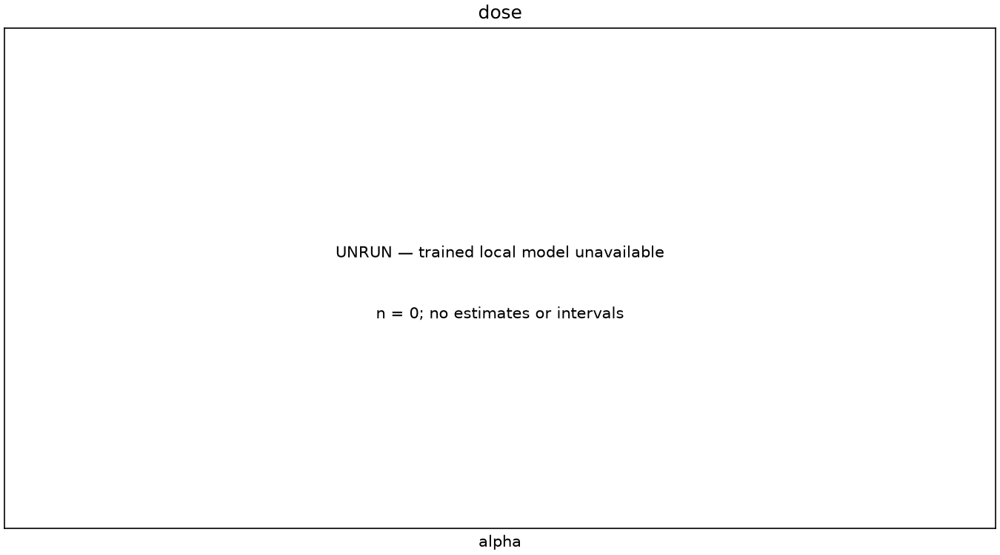
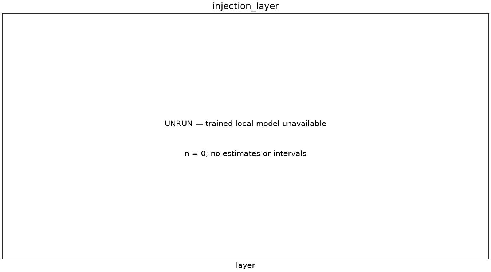
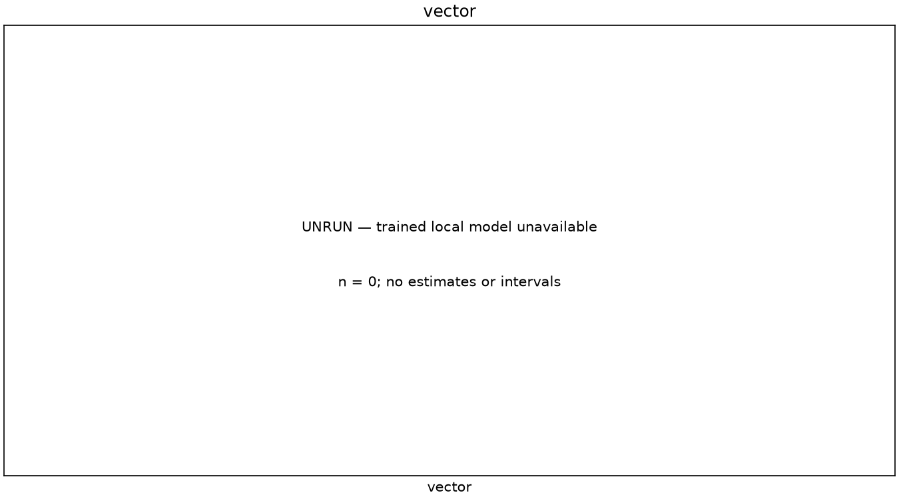
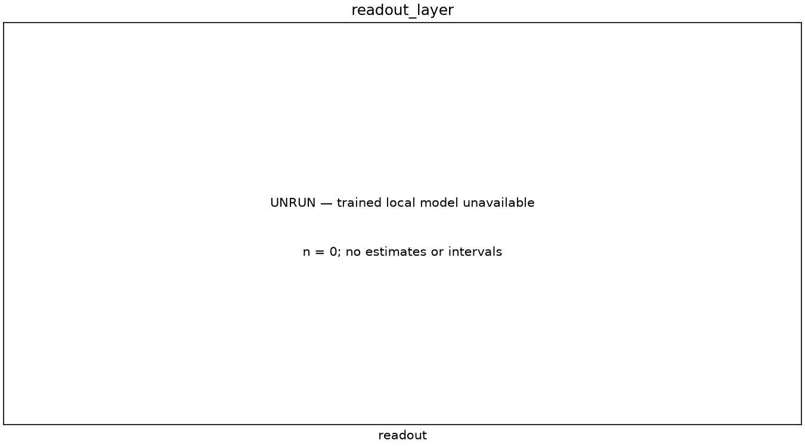
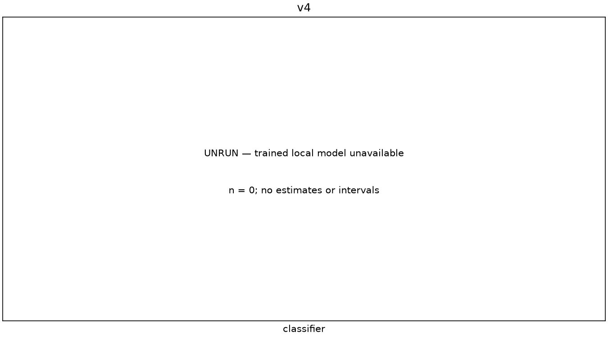
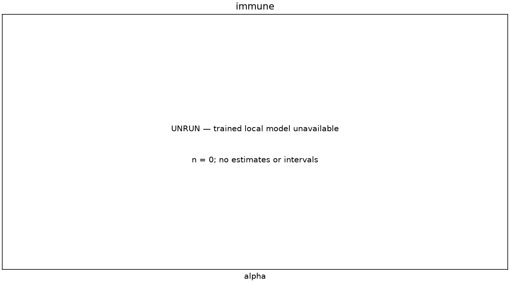
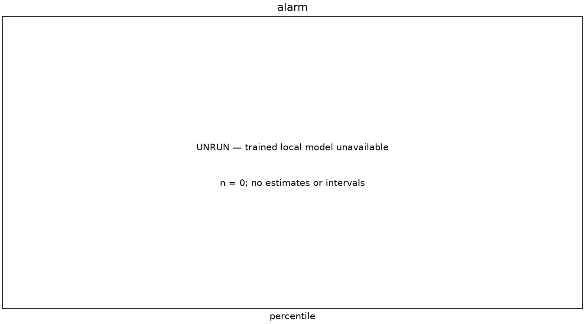
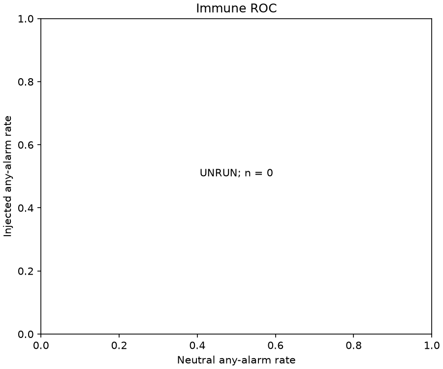
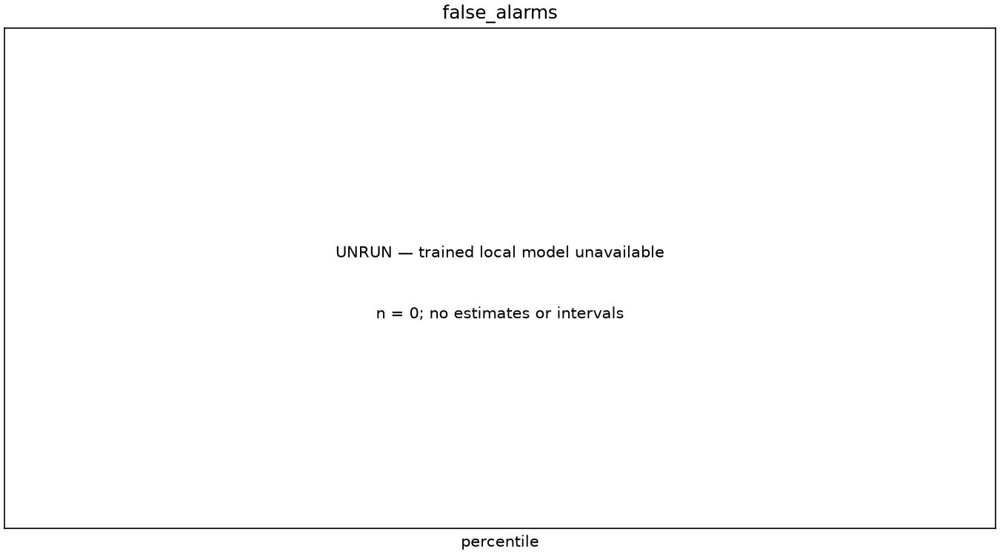
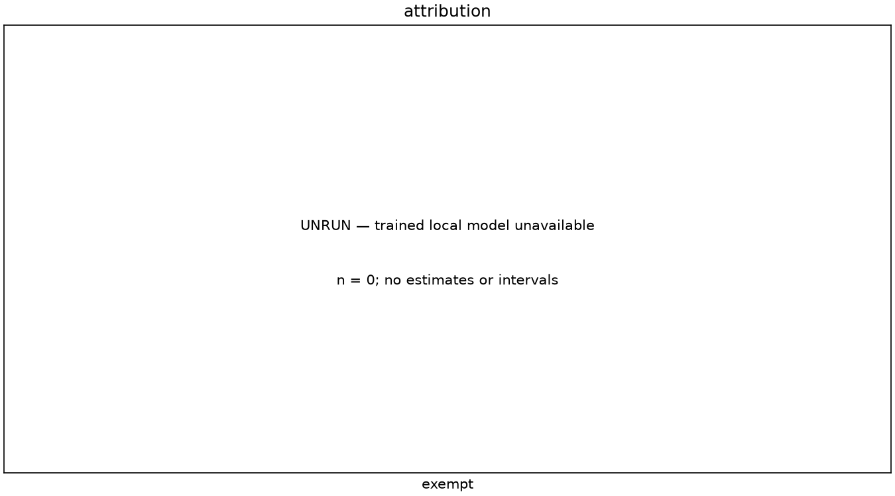

# NOUS: testing thought injection and a defending mind

Chat tries to bring an idea into a small local AI's answer.  
A Mind-Reader tries to identify that idea without seeing the chat's target.  
A separate defence tries to remove the injected signal while preserving the task.  
We committed our predictions before collecting this study's measurements.  
Every comparison below says whether it actually ran; missing evidence proves nothing.  
This is a test of a small game mechanism, with fallible measurements and limited scope.

## Abstract

We present a preregistered, offline evaluation of NOUS. Matched everyday tasks compare thought injection doses, injection locations, vector constructions, blind readouts and a projection-based Neural Immune System. We distinguish label classification from tamper detection, test held-out prompt families and seeds, and report concept-cluster uncertainty. We publish executable comparisons that can contradict our predictions. The tables distinguish executed measurements from unavailable experiments; an unrun row has no estimate, and cannot support a hypothesis.

Registered before measurement: [b1a090fc7d7325207f792b9cfe88dc3a01014d9b](https://github.com/manazafzal/codex-twitchcon-2026/commit/b1a090fc7d7325207f792b9cfe88dc3a01014d9b).

Hypotheses SHA-256: `3cbff3604c2af9b237eed9a9afa04ec4874d75cfbc26dd811fadde737ab18954`.

Design: 30 concepts; 6 prompts; seed 0; 2000 concept-cluster resamples. Model: Qwen/Qwen2.5-0.5B-Instruct. Source commit: `fa5eab803edbc6e26d2822c538d9e6211b4f477b`.

## Method

### Registered design and provenance

The linked registration fixes sampling, primary conditions, decision rules and all grids. The sweeps vary one factor around the primary condition, with matched controls, rather than searching an unspecified Cartesian product. Every cell states its actual answer count, concept-cluster count and planned answer count. Unrun cells carry reasons. A failed or empty answer prevents a cell from being reported complete. The raw-mean and seeded random-direction conditions are negative or weak baselines that may defeat the proposed construction. Confidence intervals are descriptive across this preregistered collection; there is no multiplicity correction.

We generate self-described concept sets and neutral sets from the same local model. Absolute position zero is excluded from injection, state capture, contrast means and calibration. Directions are unit length. For the leave-one-out construction, with concept means $\mu_c$, the direction is

$$
d_c=\frac{\mu_c-\frac{1}{C-1}\sum_{j\ne c}\mu_j}
{\left\|\mu_c-\frac{1}{C-1}\sum_{j\ne c}\mu_j\right\|}.
$$

Other constructions subtract a common neutral mean, retain the raw mean, subtract matched neutral generations, whiten a neutral difference with regularized covariance, or use seeded Gaussian directions. The same construction is applied independently at injection and readout layers. All share contrast texts, neutral texts, seeds and unit normalization. The paired baseline matches template and generation seed. This isolates vector construction while retaining its possible dependence on shared data.

### Injection and readout

The intervention applies to every newly processed position, including prefill except the excluded sink position:

$$
h_{L,p}\leftarrow h_{L,p}+s d_c,\qquad
s=\alpha m\left(1-e^{-D/\kappa}\right).
$$

Here $m$ is the registered reference norm and $D$ is accumulated dose. The evaluation holds the target for an answer with saturating pushes and bounded dose response. Its deliberately wider dose grid exists only in a research adapter. The public game's faction-share cap and production dose limits are unchanged.

The original blind readout evaluates every concept on a rolling mean $\bar h_R$:

$$
u_c=\cos(\bar h_R,d_c),\qquad z_c=(u_c-\mu_c^{\mathrm{neutral}})/\sigma_c^{\mathrm{neutral}}.
$$

Neutral calibration uses the same rolling-window statistic. The alternative classifier concatenates answer-mean states at registered layers. Training-only centering, standardization or regularized whitening precedes shrinkage LDA or multinomial logistic regression. LDA uses a spherical shrinkage target; logistic regression uses fixed full-batch updates. Regularization and the winning architecture use validation accuracy only, with deterministic ties. The predefined full classifier is reported separately from that winner. Training sizes are balanced nested prefixes; smaller prefixes may lack injected examples, so size and training mixture are partly confounded. Families, seeds and normalized generated-text hashes must be disjoint across training, validation and test. An overlap fails fitting rather than being quietly removed. Held-out classifier comparisons use the same texts and paired concept-cluster resampling. The held-out cosine comparison uses the stored answer mean at its layer; generation and alarm measurements use rolling token windows.

### Clamp, alarm and measurement

The clamp is applied successively over all concept directions at the layer following injection:

$$
h\leftarrow h-\max(0,h\cdot d_c-t_c)d_c.
$$

Because directions need not be orthogonal, this is a sequential operation; later updates can change earlier projections. Clamp thresholds come from neutral projections. Alarm thresholds come from fresh neutral generations. For each token, the alarm attributes the largest positive excess among concepts exceeding either a projection threshold or the calibrated readout cutoff:

$$
a_{c,t}=\max(h_t\cdot d_c-q_c,\ z_{c,t}-z_*).
$$

A same-concept consecutive-token run is required. The topical exemption suppresses concepts named by aliases or stems in the task. We compare it on ordinary tasks and explicitly topical matched tasks. A classifier-confidence alarm uses a separate neutral validation set and the same run rule; it does not replace the operational projection/z alarm. Public tamper reports remain restricted to an enabled defence. Private detector measurements can be evaluated with the defence disabled.

Keyword hit is whole-word alias occurrence; stem hit and independently neutral-calibrated embedding hit are separate secondary proxies. Task kept is the existing lexical-anchor and repetition proxy, not a human quality rating. The registered keyword comparison uses target-keyword detection. As a secondary blind label baseline, first-mentioned keyword selects the first concept alias and counts no match as wrong. The target-detection baseline is not a blind classifier. Blind cosine and classifier predictions rank all concepts. Chance is contextual, not evidence of semantic understanding.

Intervals resample concepts with replacement and retain all answers in each selected cluster. Paired differences are computed within matched concept, task and seed before resampling. Relative hit reduction is undefined when the control has no hits; bootstrap samples with undefined ratios cannot yield a complete interval. Wilson intervals are supplementary answer-level summaries, not replacements for cluster uncertainty. Tables omit runtime timing so identical artifacts and seeds can reproduce byte-identical tables. CPU generation uses deterministic algorithms and a single numerical thread where supported.

## Results

### Separately reported local checks

The project author supplied [a real-model results note](REAL_MODEL_RESULTS.md) and a fitted library after the original unavailable-artifact report. The table below reproduces that note; it is external, streamer-reported evidence, not a rerun by this paper's code or a completed cell in the registered grid. The reported intervals are described as across-idea intervals; raw outcomes and the resampling implementation were not supplied, so we do not independently verify their construction. The immune checks used an earlier library and code revision and were not repeated on the final library. The note records these limits, revisions and the artifact digest. The starter packs remain experimental and untested on the real model.

| Check | Result |
| --- | --- |
| Mind-Reader names the right idea (first guess), 360 held-out answers, 30 ideas | 94.2% (91.7 to 96.4% interval across ideas) |
| Right idea in its first three guesses | 96.1% (94.2 to 98.1%) |
| Same test before fitting the Mind-Reader | 47.5% first guess, 66.7% first three |
| Nobody pushing: says "No clear thought yet" | 192 of 192 |
| Rounds with pushes: reading names the pushed idea | 320 of 320 |
| Neural Immune System: false alarms on normal answers | 0 of 20 |
| Neural Immune System: pushed answers caught | 20 of 20 |

Source: [streamer-supplied results and limits](REAL_MODEL_RESULTS.md).

### Preregistered study status

The decision table applies the registered rules. Crossing a required confidence bound is inconclusive; absent observations remain unrun. Neither outcome is silently converted to support. Tables and figures below are generated exclusively from the evidence artifacts. Full machine-readable grids accompany the condensed classifier and alarm views. No exploratory hints are treated as results.

| clusters | decision | hypothesis | n | reason | status |
| --- | --- | --- | --- | --- | --- |
| 0 | unrun; required component unavailable | H1 | 0 | Paired keyword difference | unrun |
| 0 | unrun; required component unavailable | H2 | 0 | Complete dose grid unavailable | unrun |
| 0 | unrun; required component unavailable | H3 | 0 | Nonnegative paired bounds on both outcomes against both baselines | unrun |
| 0 | unrun; required component unavailable | H4 | 0 | Blind all-concept cosine readout | unrun |
| 0 | unrun; required component unavailable | H5 | 0 | Relative reduction, task proxy and neutral false alarms; ratio undefined for zero control | unrun |
| 0 | unrun; required component unavailable | H6 | 0 | Disjoint held-out families, seeds and hashes | unrun |
| 0 | unrun; required component unavailable | H7 | 0 | Matched injected accuracy and independent neutral detector comparison | unrun |
| 0 | unrun; required component unavailable | H8 | 0 | Paired mean middle-layer minus late-layer hit | unrun |

[Complete hypotheses table](../research/tables/hypotheses.csv)

### Dose, task retention and injection location

| alpha | clusters | immune | layer | n | planned_n | readout | reason | status | topical | vector |
| --- | --- | --- | --- | --- | --- | --- | --- | --- | --- | --- |
| 0 | 0 | False | 16 | 0 | 180 | 20 | Local trained model unavailable; no runtime download or substitute evidence | unrun | False | others |
| 0.15 | 0 | False | 16 | 0 | 180 | 20 | Local trained model unavailable; no runtime download or substitute evidence | unrun | False | others |
| 0.3 | 0 | False | 16 | 0 | 180 | 20 | Local trained model unavailable; no runtime download or substitute evidence | unrun | False | others |
| 0.45 | 0 | False | 16 | 0 | 180 | 20 | Local trained model unavailable; no runtime download or substitute evidence | unrun | False | others |
| 0.6 | 0 | False | 16 | 0 | 180 | 20 | Local trained model unavailable; no runtime download or substitute evidence | unrun | False | others |
| 0.75 | 0 | False | 16 | 0 | 180 | 20 | Local trained model unavailable; no runtime download or substitute evidence | unrun | False | others |
| 1 | 0 | False | 16 | 0 | 180 | 20 | Local trained model unavailable; no runtime download or substitute evidence | unrun | False | others |
| 1.25 | 0 | False | 16 | 0 | 180 | 20 | Local trained model unavailable; no runtime download or substitute evidence | unrun | False | others |
| 1.5 | 0 | False | 16 | 0 | 180 | 20 | Local trained model unavailable; no runtime download or substitute evidence | unrun | False | others |

[Complete dose table](../research/tables/dose.csv)

| alpha | clusters | immune | layer | n | planned_n | readout | reason | status | topical | vector |
| --- | --- | --- | --- | --- | --- | --- | --- | --- | --- | --- |
| 0 | 0 | False | 4 | 0 | 180 | 20 | Local trained model unavailable; no runtime download or substitute evidence | unrun | False | others |
| 0.45 | 0 | False | 4 | 0 | 180 | 20 | Local trained model unavailable; no runtime download or substitute evidence | unrun | False | others |
| 0 | 0 | False | 8 | 0 | 180 | 20 | Local trained model unavailable; no runtime download or substitute evidence | unrun | False | others |
| 0.45 | 0 | False | 8 | 0 | 180 | 20 | Local trained model unavailable; no runtime download or substitute evidence | unrun | False | others |
| 0 | 0 | False | 9 | 0 | 180 | 20 | Local trained model unavailable; no runtime download or substitute evidence | unrun | False | others |
| 0.45 | 0 | False | 9 | 0 | 180 | 20 | Local trained model unavailable; no runtime download or substitute evidence | unrun | False | others |
| 0 | 0 | False | 12 | 0 | 180 | 20 | Local trained model unavailable; no runtime download or substitute evidence | unrun | False | others |
| 0.45 | 0 | False | 12 | 0 | 180 | 20 | Local trained model unavailable; no runtime download or substitute evidence | unrun | False | others |
| 0 | 0 | False | 13 | 0 | 180 | 20 | Local trained model unavailable; no runtime download or substitute evidence | unrun | False | others |
| 0.45 | 0 | False | 13 | 0 | 180 | 20 | Local trained model unavailable; no runtime download or substitute evidence | unrun | False | others |
| 0 | 0 | False | 16 | 0 | 180 | 20 | Local trained model unavailable; no runtime download or substitute evidence | unrun | False | others |
| 0.45 | 0 | False | 16 | 0 | 180 | 20 | Local trained model unavailable; no runtime download or substitute evidence | unrun | False | others |
| 0 | 0 | False | 18 | 0 | 180 | 20 | Local trained model unavailable; no runtime download or substitute evidence | unrun | False | others |
| 0.45 | 0 | False | 18 | 0 | 180 | 20 | Local trained model unavailable; no runtime download or substitute evidence | unrun | False | others |
| 0 | 0 | False | 20 | 0 | 180 | 20 | Local trained model unavailable; no runtime download or substitute evidence | unrun | False | others |
| 0.45 | 0 | False | 20 | 0 | 180 | 20 | Local trained model unavailable; no runtime download or substitute evidence | unrun | False | others |

[Complete injection_layer table](../research/tables/injection_layer.csv)

### Vector construction and blind readout

| alpha | clusters | immune | layer | n | planned_n | readout | reason | status | topical | vector |
| --- | --- | --- | --- | --- | --- | --- | --- | --- | --- | --- |
| 0 | 0 | False | 16 | 0 | 180 | 20 | Local trained model unavailable; no runtime download or substitute evidence | unrun | False | others |
| 0.45 | 0 | False | 16 | 0 | 180 | 20 | Local trained model unavailable; no runtime download or substitute evidence | unrun | False | others |
| 0 | 0 | False | 16 | 0 | 180 | 20 | Local trained model unavailable; no runtime download or substitute evidence | unrun | False | neutral |
| 0.45 | 0 | False | 16 | 0 | 180 | 20 | Local trained model unavailable; no runtime download or substitute evidence | unrun | False | neutral |
| 0 | 0 | False | 16 | 0 | 180 | 20 | Local trained model unavailable; no runtime download or substitute evidence | unrun | False | raw |
| 0.45 | 0 | False | 16 | 0 | 180 | 20 | Local trained model unavailable; no runtime download or substitute evidence | unrun | False | raw |
| 0 | 0 | False | 16 | 0 | 180 | 20 | Local trained model unavailable; no runtime download or substitute evidence | unrun | False | paired |
| 0.45 | 0 | False | 16 | 0 | 180 | 20 | Local trained model unavailable; no runtime download or substitute evidence | unrun | False | paired |
| 0 | 0 | False | 16 | 0 | 180 | 20 | Local trained model unavailable; no runtime download or substitute evidence | unrun | False | whitened |
| 0.45 | 0 | False | 16 | 0 | 180 | 20 | Local trained model unavailable; no runtime download or substitute evidence | unrun | False | whitened |
| 0 | 0 | False | 16 | 0 | 180 | 20 | Local trained model unavailable; no runtime download or substitute evidence | unrun | False | random |
| 0.45 | 0 | False | 16 | 0 | 180 | 20 | Local trained model unavailable; no runtime download or substitute evidence | unrun | False | random |

[Complete vector table](../research/tables/vector.csv)

| alpha | clusters | immune | layer | n | planned_n | readout | reason | status | topical | vector |
| --- | --- | --- | --- | --- | --- | --- | --- | --- | --- | --- |
| 0 | 0 | False | 16 | 0 | 180 | 12 | Local trained model unavailable; no runtime download or substitute evidence | unrun | False | others |
| 0.45 | 0 | False | 16 | 0 | 180 | 12 | Local trained model unavailable; no runtime download or substitute evidence | unrun | False | others |
| 0 | 0 | False | 16 | 0 | 180 | 13 | Local trained model unavailable; no runtime download or substitute evidence | unrun | False | others |
| 0.45 | 0 | False | 16 | 0 | 180 | 13 | Local trained model unavailable; no runtime download or substitute evidence | unrun | False | others |
| 0 | 0 | False | 16 | 0 | 180 | 14 | Local trained model unavailable; no runtime download or substitute evidence | unrun | False | others |
| 0.45 | 0 | False | 16 | 0 | 180 | 14 | Local trained model unavailable; no runtime download or substitute evidence | unrun | False | others |
| 0 | 0 | False | 16 | 0 | 180 | 15 | Local trained model unavailable; no runtime download or substitute evidence | unrun | False | others |
| 0.45 | 0 | False | 16 | 0 | 180 | 15 | Local trained model unavailable; no runtime download or substitute evidence | unrun | False | others |
| 0 | 0 | False | 16 | 0 | 180 | 16 | Local trained model unavailable; no runtime download or substitute evidence | unrun | False | others |
| 0.45 | 0 | False | 16 | 0 | 180 | 16 | Local trained model unavailable; no runtime download or substitute evidence | unrun | False | others |
| 0 | 0 | False | 16 | 0 | 180 | 17 | Local trained model unavailable; no runtime download or substitute evidence | unrun | False | others |
| 0.45 | 0 | False | 16 | 0 | 180 | 17 | Local trained model unavailable; no runtime download or substitute evidence | unrun | False | others |
| 0 | 0 | False | 16 | 0 | 180 | 18 | Local trained model unavailable; no runtime download or substitute evidence | unrun | False | others |
| 0.45 | 0 | False | 16 | 0 | 180 | 18 | Local trained model unavailable; no runtime download or substitute evidence | unrun | False | others |
| 0 | 0 | False | 16 | 0 | 180 | 19 | Local trained model unavailable; no runtime download or substitute evidence | unrun | False | others |
| 0.45 | 0 | False | 16 | 0 | 180 | 19 | Local trained model unavailable; no runtime download or substitute evidence | unrun | False | others |
| 0 | 0 | False | 16 | 0 | 180 | 20 | Local trained model unavailable; no runtime download or substitute evidence | unrun | False | others |
| 0.45 | 0 | False | 16 | 0 | 180 | 20 | Local trained model unavailable; no runtime download or substitute evidence | unrun | False | others |
| 0 | 0 | False | 16 | 0 | 180 | 21 | Local trained model unavailable; no runtime download or substitute evidence | unrun | False | others |
| 0.45 | 0 | False | 16 | 0 | 180 | 21 | Local trained model unavailable; no runtime download or substitute evidence | unrun | False | others |
| 0 | 0 | False | 16 | 0 | 180 | 22 | Local trained model unavailable; no runtime download or substitute evidence | unrun | False | others |
| 0.45 | 0 | False | 16 | 0 | 180 | 22 | Local trained model unavailable; no runtime download or substitute evidence | unrun | False | others |

[Complete readout_layer table](../research/tables/readout_layer.csv)

### Held-out classifier comparison

The table includes the predefined full classifier and, when fitted, the validation-selected variant. Its held-out outcomes do not influence selection. Residual errors may involve neighbouring concepts; finite-sample accuracy is never a guarantee.

| classifier | clusters | layers | n | planned_n | reason | status | train_size | whitening |
| --- | --- | --- | --- | --- | --- | --- | --- | --- |
| lda | 0 | [16,20,22] | 0 | 360 | Local trained model unavailable; no runtime download or substitute evidence | unrun | 66 | standardize |

[Complete v4 table](../research/tables/v4.csv)

### Defence and attribution

| alpha | clusters | immune | layer | n | planned_n | readout | reason | status | topical | vector |
| --- | --- | --- | --- | --- | --- | --- | --- | --- | --- | --- |
| 0 | 0 | False | 16 | 0 | 180 | 20 | Local trained model unavailable; no runtime download or substitute evidence | unrun | False | others |
| 0 | 0 | False | 16 | 0 | 180 | 20 | Local trained model unavailable; no runtime download or substitute evidence | unrun | True | others |
| 0 | 0 | True | 16 | 0 | 180 | 20 | Local trained model unavailable; no runtime download or substitute evidence | unrun | False | others |
| 0 | 0 | True | 16 | 0 | 180 | 20 | Local trained model unavailable; no runtime download or substitute evidence | unrun | True | others |
| 0.45 | 0 | False | 16 | 0 | 180 | 20 | Local trained model unavailable; no runtime download or substitute evidence | unrun | False | others |
| 0.45 | 0 | False | 16 | 0 | 180 | 20 | Local trained model unavailable; no runtime download or substitute evidence | unrun | True | others |
| 0.45 | 0 | True | 16 | 0 | 180 | 20 | Local trained model unavailable; no runtime download or substitute evidence | unrun | False | others |
| 0.45 | 0 | True | 16 | 0 | 180 | 20 | Local trained model unavailable; no runtime download or substitute evidence | unrun | True | others |

[Complete immune table](../research/tables/immune.csv)

| alpha | clusters | exempt | immune | n | percentile | planned_n | reason | run | status | topical | z |
| --- | --- | --- | --- | --- | --- | --- | --- | --- | --- | --- | --- |
| 0 | 0 | False | False | 0 | 99.5 | 180 | Local trained model unavailable; no runtime download or substitute evidence | 8 | unrun | False | 4 |
| 0 | 0 | False | False | 0 | 99.5 | 180 | Local trained model unavailable; no runtime download or substitute evidence | 8 | unrun | True | 4 |
| 0 | 0 | False | True | 0 | 99.5 | 180 | Local trained model unavailable; no runtime download or substitute evidence | 8 | unrun | False | 4 |
| 0 | 0 | False | True | 0 | 99.5 | 180 | Local trained model unavailable; no runtime download or substitute evidence | 8 | unrun | True | 4 |
| 0.45 | 0 | False | False | 0 | 99.5 | 180 | Local trained model unavailable; no runtime download or substitute evidence | 8 | unrun | False | 4 |
| 0.45 | 0 | False | False | 0 | 99.5 | 180 | Local trained model unavailable; no runtime download or substitute evidence | 8 | unrun | True | 4 |
| 0.45 | 0 | False | True | 0 | 99.5 | 180 | Local trained model unavailable; no runtime download or substitute evidence | 8 | unrun | False | 4 |
| 0.45 | 0 | False | True | 0 | 99.5 | 180 | Local trained model unavailable; no runtime download or substitute evidence | 8 | unrun | True | 4 |
| 0 | 0 | True | False | 0 | 99.5 | 180 | Local trained model unavailable; no runtime download or substitute evidence | 8 | unrun | False | 4 |
| 0 | 0 | True | False | 0 | 99.5 | 180 | Local trained model unavailable; no runtime download or substitute evidence | 8 | unrun | True | 4 |
| 0 | 0 | True | True | 0 | 99.5 | 180 | Local trained model unavailable; no runtime download or substitute evidence | 8 | unrun | False | 4 |
| 0 | 0 | True | True | 0 | 99.5 | 180 | Local trained model unavailable; no runtime download or substitute evidence | 8 | unrun | True | 4 |
| 0.45 | 0 | True | False | 0 | 99.5 | 180 | Local trained model unavailable; no runtime download or substitute evidence | 8 | unrun | False | 4 |
| 0.45 | 0 | True | False | 0 | 99.5 | 180 | Local trained model unavailable; no runtime download or substitute evidence | 8 | unrun | True | 4 |
| 0.45 | 0 | True | True | 0 | 99.5 | 180 | Local trained model unavailable; no runtime download or substitute evidence | 8 | unrun | False | 4 |
| 0.45 | 0 | True | True | 0 | 99.5 | 180 | Local trained model unavailable; no runtime download or substitute evidence | 8 | unrun | True | 4 |

[Complete alarm table](../research/tables/alarm.csv)

### Matched differences

| cluster_ci95 | clusters | comparison | mean | metric | n | planned_n | reason | status |
| --- | --- | --- | --- | --- | --- | --- | --- | --- |
| unavailable | 0 | H1 dose minus control | unavailable | keyword_hit | 0 | 180 | Matched complete generations unavailable | unrun |
| unavailable | 0 | H2 task 0.15 minus 0 | unavailable | task_kept | 0 | 180 | Matched complete generations unavailable | unrun |
| unavailable | 0 | H2 task 0.3 minus 0.15 | unavailable | task_kept | 0 | 180 | Matched complete generations unavailable | unrun |
| unavailable | 0 | H2 task 0.45 minus 0.3 | unavailable | task_kept | 0 | 180 | Matched complete generations unavailable | unrun |
| unavailable | 0 | H2 task 0.6 minus 0.45 | unavailable | task_kept | 0 | 180 | Matched complete generations unavailable | unrun |
| unavailable | 0 | H2 task 0.75 minus 0.6 | unavailable | task_kept | 0 | 180 | Matched complete generations unavailable | unrun |
| unavailable | 0 | H2 task 1 minus 0.75 | unavailable | task_kept | 0 | 180 | Matched complete generations unavailable | unrun |
| unavailable | 0 | H2 task 1.25 minus 1 | unavailable | task_kept | 0 | 180 | Matched complete generations unavailable | unrun |
| unavailable | 0 | H2 task 1.5 minus 1.25 | unavailable | task_kept | 0 | 180 | Matched complete generations unavailable | unrun |
| unavailable | 0 | H3 others minus neutral | unavailable | keyword_hit | 0 | 180 | Matched complete generations unavailable | unrun |
| unavailable | 0 | H3 others minus neutral | unavailable | cosine_top1 | 0 | 180 | Matched complete generations unavailable | unrun |
| unavailable | 0 | H3 others minus raw | unavailable | keyword_hit | 0 | 180 | Matched complete generations unavailable | unrun |
| unavailable | 0 | H3 others minus raw | unavailable | cosine_top1 | 0 | 180 | Matched complete generations unavailable | unrun |
| — | 0 | H4 cosine minus target keyword | — | — | 0 | 180 | Primary generations unavailable | unrun |
| unavailable | 0 | H5 immune on minus off | unavailable | keyword_hit | 0 | 180 | Matched complete generations unavailable | unrun |
| — | 0 | H5 relative reduction | — | — | 0 | 180 | Matched immune generations unavailable | unrun |
| — | 0 | H7 classifier minus cosine false alarms | — | — | 0 | 180 | Independent classifier calibration unavailable | unrun |
| — | 0 | H8 middle minus late | — | — | 0 | 180 | Complete matched layer grid unavailable | unrun |

[Complete paired table](../research/tables/paired.csv)

| alpha | clusters | grid | immune | layer | n | planned_n | readout | reason | status | topical | vector |
| --- | --- | --- | --- | --- | --- | --- | --- | --- | --- | --- | --- |
| 0.15 | 0 | dose | False | 16 | 0 | 180 | 20 | Complete matched alpha-zero control unavailable | unrun | False | others |
| 0.3 | 0 | dose | False | 16 | 0 | 180 | 20 | Complete matched alpha-zero control unavailable | unrun | False | others |
| 0.45 | 0 | dose | False | 16 | 0 | 180 | 20 | Complete matched alpha-zero control unavailable | unrun | False | others |
| 0.6 | 0 | dose | False | 16 | 0 | 180 | 20 | Complete matched alpha-zero control unavailable | unrun | False | others |
| 0.75 | 0 | dose | False | 16 | 0 | 180 | 20 | Complete matched alpha-zero control unavailable | unrun | False | others |
| 1 | 0 | dose | False | 16 | 0 | 180 | 20 | Complete matched alpha-zero control unavailable | unrun | False | others |
| 1.25 | 0 | dose | False | 16 | 0 | 180 | 20 | Complete matched alpha-zero control unavailable | unrun | False | others |
| 1.5 | 0 | dose | False | 16 | 0 | 180 | 20 | Complete matched alpha-zero control unavailable | unrun | False | others |
| 0.45 | 0 | injection_layer | False | 4 | 0 | 180 | 20 | Complete matched alpha-zero control unavailable | unrun | False | others |
| 0.45 | 0 | injection_layer | False | 8 | 0 | 180 | 20 | Complete matched alpha-zero control unavailable | unrun | False | others |
| 0.45 | 0 | injection_layer | False | 9 | 0 | 180 | 20 | Complete matched alpha-zero control unavailable | unrun | False | others |
| 0.45 | 0 | injection_layer | False | 12 | 0 | 180 | 20 | Complete matched alpha-zero control unavailable | unrun | False | others |
| 0.45 | 0 | injection_layer | False | 13 | 0 | 180 | 20 | Complete matched alpha-zero control unavailable | unrun | False | others |
| 0.45 | 0 | injection_layer | False | 16 | 0 | 180 | 20 | Complete matched alpha-zero control unavailable | unrun | False | others |
| 0.45 | 0 | injection_layer | False | 18 | 0 | 180 | 20 | Complete matched alpha-zero control unavailable | unrun | False | others |
| 0.45 | 0 | injection_layer | False | 20 | 0 | 180 | 20 | Complete matched alpha-zero control unavailable | unrun | False | others |
| 0.45 | 0 | vector | False | 16 | 0 | 180 | 20 | Complete matched alpha-zero control unavailable | unrun | False | others |
| 0.45 | 0 | vector | False | 16 | 0 | 180 | 20 | Complete matched alpha-zero control unavailable | unrun | False | neutral |
| 0.45 | 0 | vector | False | 16 | 0 | 180 | 20 | Complete matched alpha-zero control unavailable | unrun | False | raw |
| 0.45 | 0 | vector | False | 16 | 0 | 180 | 20 | Complete matched alpha-zero control unavailable | unrun | False | paired |
| 0.45 | 0 | vector | False | 16 | 0 | 180 | 20 | Complete matched alpha-zero control unavailable | unrun | False | whitened |
| 0.45 | 0 | vector | False | 16 | 0 | 180 | 20 | Complete matched alpha-zero control unavailable | unrun | False | random |
| 0.45 | 0 | readout_layer | False | 16 | 0 | 180 | 12 | Complete matched alpha-zero control unavailable | unrun | False | others |
| 0.45 | 0 | readout_layer | False | 16 | 0 | 180 | 13 | Complete matched alpha-zero control unavailable | unrun | False | others |
| 0.45 | 0 | readout_layer | False | 16 | 0 | 180 | 14 | Complete matched alpha-zero control unavailable | unrun | False | others |
| 0.45 | 0 | readout_layer | False | 16 | 0 | 180 | 15 | Complete matched alpha-zero control unavailable | unrun | False | others |
| 0.45 | 0 | readout_layer | False | 16 | 0 | 180 | 16 | Complete matched alpha-zero control unavailable | unrun | False | others |
| 0.45 | 0 | readout_layer | False | 16 | 0 | 180 | 17 | Complete matched alpha-zero control unavailable | unrun | False | others |
| 0.45 | 0 | readout_layer | False | 16 | 0 | 180 | 18 | Complete matched alpha-zero control unavailable | unrun | False | others |
| 0.45 | 0 | readout_layer | False | 16 | 0 | 180 | 19 | Complete matched alpha-zero control unavailable | unrun | False | others |
| 0.45 | 0 | readout_layer | False | 16 | 0 | 180 | 20 | Complete matched alpha-zero control unavailable | unrun | False | others |
| 0.45 | 0 | readout_layer | False | 16 | 0 | 180 | 21 | Complete matched alpha-zero control unavailable | unrun | False | others |
| 0.45 | 0 | readout_layer | False | 16 | 0 | 180 | 22 | Complete matched alpha-zero control unavailable | unrun | False | others |
| 0.45 | 0 | immune | False | 16 | 0 | 180 | 20 | Complete matched alpha-zero control unavailable | unrun | False | others |
| 0.45 | 0 | immune | False | 16 | 0 | 180 | 20 | Complete matched alpha-zero control unavailable | unrun | True | others |
| 0.45 | 0 | immune | True | 16 | 0 | 180 | 20 | Complete matched alpha-zero control unavailable | unrun | False | others |
| 0.45 | 0 | immune | True | 16 | 0 | 180 | 20 | Complete matched alpha-zero control unavailable | unrun | True | others |

[Complete paired_control table](../research/tables/paired_control.csv)

## Limitations

This study is limited to one half-billion-parameter local model, thirty concepts, six ordinary task prompts and one primary generation seed. The classifier's additional split seeds test a different question and do not turn the generation experiment into a multi-seed study. Keyword and embedding proxies can miss valid meanings or reward irrelevant mentions; the task proxy can accept a poor answer or reject a good paraphrase. Human task-quality ratings are absent.

The readout comes from the same model family and representations as the injection. The classifier also observes the injection layer before the defence, so accurate labels under defence do not establish that the concept survived the clamp. The library is fitted on data it also reads, so successful classification is partly a test of that construction rather than independent evidence about a model's inner experience. Held-out prompt families and seeds reduce some overlap but do not remove this dependence. Contrast sets and readout calibration are reused across ablations, with shared estimation uncertainty not fully represented by an answer-cluster bootstrap. Training-size prefixes change both sample count and injected-answer mixture.

CPU determinism concerns the specified local environment. Other numerical libraries, CPU instructions or package versions may change generated tokens; fixed seeds do not promise identical output across hardware. Local trained weights and the optional plotting dependency are required to regenerate empirical results. Unrun rows disclose unavailable evidence, rather than establish safety or effectiveness. The wider research doses are experimental and do not alter the game's production limits. Public chat secrecy and viewer fairness require their separate existing tests; these ablations alone cannot establish them.
